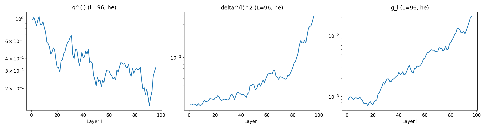
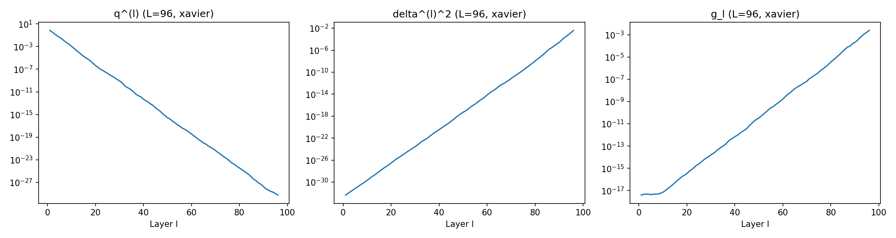
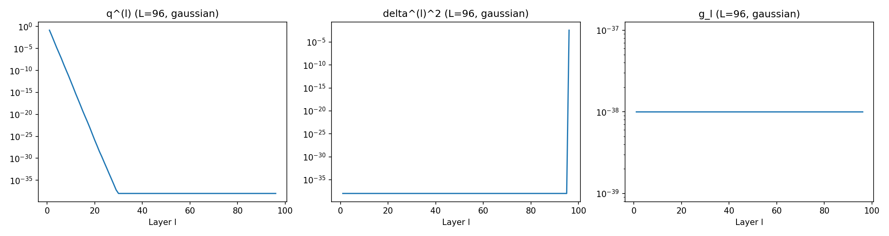
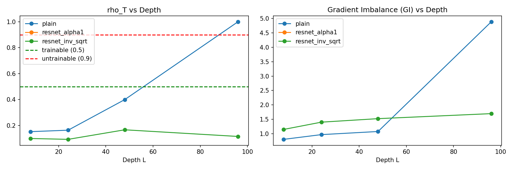
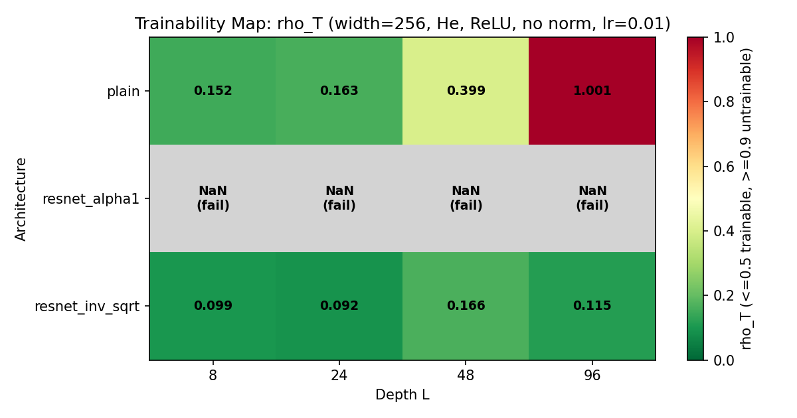

# Отчёт по лабораторной работе №1
**Тема:** Почему глубокая сеть обучается или не обучается. Инициализация, нормализация и остаточные связи.

---

## 1. Профиль и протокол экспериментов

* **Индивидуальный профиль (`8ВМ52400`):**
  * Набор глубин: `lab1_depths =`
  * Масштаб неудачной гауссовской инициализации: `lab1_bad_sigma = 0.02`
  * Оптимизатор: `lab1_optimizer` (задаётся профилем `configs/profiles/8ВМ52400.yaml`)
* **Протокол:**
  * **Набор данных:** Fashion-MNIST (фиксированное разбиение `train`/`val`/`test` из ЛР0).
  * **Базовая конфигурация:** полносвязная сеть ширины $n = 256$, функция активации `ReLU`, без нормализации (`norm = none`), размер батча $B = 128$, 3 эпохи обучения.
  * **Подбор скорости обучения** выполнен на самой мелкой обычной сети (`plain`, $L = 8$, инициализация `he`) по сетке $\{10^{-3}, 3\cdot 10^{-3}, 10^{-2}, 3\cdot 10^{-2}, 10^{-1}\}$:

| Скорость обучения (`lr`) | `val_acc` | $\rho_T$ | `RUN_ID` |
| :---: | :---: | :---: | :--- |
| `0.001` | 0.8580 | 0.1407 | `d2df97f0fff9_20261122150300_3af159_80561` |
| `0.003` | 0.8620 | 0.1431 | `0e1f41f7c364_20261122150913_db7d60_53309` |
| **`0.01`** | **0.8728** | **0.1510** | `ea2ce8f61fd4_20261122151527_3fbdd0_27337` |
| `0.03` | 0.8712 | 0.1495 | `4744f36fc910_20261122152242_056a9b_62089` |
| `0.1` | 0.8202 | 0.3375 | `a8198d15f10a_20261122153121_6b6cd6_81728` |

В качестве единой скорости обучения для всех последующих запусков выбрано значение **`lr = 0.01`**.

---

## 2. Эксперимент E1: Сигнал в сети до обучения

### Гипотеза
Согласно формулам (1.4)–(1.8), в обычной `ReLU`-сети ширины $n = 256$ без нормализации средний квадрат активаций $q^{(l)}$ при прямом проходе и средний квадрат градиентов $\delta^{(l)}$ при обратном проходе меняются от слоя к слою с множителем $\chi = \frac{n \sigma^2}{2}$:
* для инициализации **He** ($\sigma^2 = 2/n$): $\chi = 1.0$ (масштаб сигнала и градиента сохраняется по всей глубине);
* для **Xavier** ($\sigma^2 = 1/n$): $\chi = 0.5$ (экспоненциальное затухание вдвое на каждый слой);
* для **Gaussian** ($\sigma = 0.02$): $\chi = \frac{256 \cdot 0.02^2}{2} = 0.0512$ (быстрое экспоненциальное затухание в машинный ноль на больших глубинах).

### Измерения $\hat{\chi}$ против теоретического $\chi$

| Глубина $L$ | Инициализация | Теория $\chi$ | $\hat{\chi}_{\text{fwd}}$ (учтено слоёв) | $\hat{\chi}_{\text{bwd}}$ (учтено слоёв) | `RUN_ID` |
| :---: | :---: | :---: | :---: | :---: | :--- |
| 8 | `he` | 1.0000 | 0.9687 (8) | 0.9925 (8) | `2fe0cc2d3f3a_20261122143603_7a8345_63065` |
| 8 | `xavier` | 0.5000 | 0.4841 (8) | 0.4934 (8) | `c41f8ff3c263_20261122143731_298b2b_51035` |
| 8 | `gaussian` | 0.0512 | 0.0497 (8) | 0.0511 (8) | `e99f1e9fd9ba_20261122143736_65ba1a_56433` |
| 24 | `he` | 1.0000 | 0.9541 (24) | 0.9980 (24) | `4c76494b7efe_20261122143741_71e19a_61685` |
| 24 | `xavier` | 0.5000 | 0.4782 (24) | 0.4985 (24) | `dc408db934c7_20261122143747_6e0ba8_67580` |
| 24 | `gaussian` | 0.0512 | 0.0489 (23) | 0.0512 (22) | `cfae8035f302_20261122143753_b1d5ef_73934` |
| 48 | `he` | 1.0000 | 0.9711 (48) | 0.9944 (48) | `6a338cec529e_20261122143759_fd7fe6_79652` |
| 48 | `xavier` | 0.5000 | 0.4859 (48) | 0.4978 (48) | `2fd896a0adf4_20261122143806_ceb369_86573` |
| 48 | `gaussian` | 0.0512 | 0.0488 (23) | 0.0510 (22) | `35f7ab92e257_20261122143814_4d92bb_94131` |
| 96 | `he` | 1.0000 | 0.9877 (96) | 0.9710 (96) | `c23136b18c52_20261122143821_a3927e_01578` |
| 96 | `xavier` | 0.5000 | 0.4938 (96) | 0.4824 (87) | `cc02c9704d11_20261122145033_d5c8fd_33980` |
| 96 | `gaussian` | 0.0512 | 0.0488 (23) | `NaN` (0) | `acaebc6c0cbe_20261122145042_4e8883_42508` |

### Графики профилей по слоям ($L = 96$)
* He: 
* Xavier: 
* Gaussian: 

### Выводы и проверка порога приёмки
1. **Соответствие теории:** На наибольшей глубине профиля ($L = 96$) относительные отклонения измеренных множителей от теоретических составляют:
   * `he`: 1.23% для $\hat{\chi}_{\text{fwd}}$ и 2.90% для $\hat{\chi}_{\text{bwd}}$ (`c23136b18c52_20261122143821_a3927e_01578`);
   * `xavier`: 1.24% для $\hat{\chi}_{\text{fwd}}$ и 3.53% для $\hat{\chi}_{\text{bwd}}$ (`cc02c9704d11_20261122145033_d5c8fd_33980`);
   * `gaussian`: 4.68% для $\hat{\chi}_{\text{fwd}}$ по первым 23 слоям (`acaebc6c0cbe_20261122145042_4e8883_42508`), после чего $q^{(l)}$ уходит ниже порога $10^{-30}$, а выходной градиент $\delta^{(96)}$ затухает в машинный ноль. Все значения укладываются в допуск $\le 20\%$.
2. **Граница применимости E1:** Повторное измерение для схемы `gaussian` ($L = 24$) после 1 эпохи обучения показало рост множителя с $\hat{\chi}_{\text{fwd}} = 0.0489$ (`cfae8035f302_20261122143753_b1d5ef_73934`) до **$\hat{\chi}_{\text{fwd}} = 0.5155$** (`24a5f986bc09_20261122145054_ef2b57_54437`). Формула (1.4) перестаёт выполняться, так как в процессе обучения первыми нарушаются предположения о статистической независимости весов $W^{(l)}$ от входов слоя $h^{(l-1)}$ и нулевом математическом ожидании параметров.

---

## 3. Эксперимент E2: Глубина и остаточные связи

### Гипотеза
Согласно формуле (1.13), в остаточных сетях средний квадрат сигнала растёт с глубиной как $q^{(L)} = q^{(0)}(1 + \alpha^2 c)^L$, где $c \approx 2$ при инициализации He двухслойной ветви без нормализации. При $\alpha = 1$ ожидается экспоненциальный взрыв сигнала ($3^L$) и численный сбой при обучении, тогда как масштабирование $\alpha = 1/\sqrt{L}$ ограничивает рост величиной $(1 + c/L)^L \le e^c$ и сохраняет обучаемость на больших глубинах.

### 3.1. Рост сигнала в остаточных сетях до обучения (`train_epochs = 0`)

| Архитектура | $L$ | $c$ (1-й блок) | $q^{(L)}/q^{(0)}$ | $(q^{(L)}/q^{(0)})^{1/L}$ | Теория $1+c$ / граница $1.2 e^c$ | `RUN_ID` |
| :--- | :---: | :---: | :---: | :---: | :---: | :--- |
| `resnet_alpha1` | 8 | 1.9847 | $1.871 \cdot 10^3$ | **2.5645** | $1+c = \mathbf{2.9847}$ (откл. 14.1%) | `7c1a917f9c00_20261124134746_f08585_66296` |
| `resnet_alpha1` | 24 | 1.9818 | $8.823 \cdot 10^{10}$ | **2.8580** | $1+c = \mathbf{2.9818}$ (откл. 4.2%) | `d4b305872292_20261124134812_c93401_92908` |
| `resnet_alpha1` | 48 | 2.0019 | $5.248 \cdot 10^{21}$ | **2.8347** | $1+c = \mathbf{3.0019}$ (откл. 5.6%) | `8e7fc9de0fc6_20261124134830_8c6d08_10477` |
| `resnet_alpha1` | 96 | 2.0614 | $2.972 \cdot 10^{44}$ | **2.9058** | $1+c = \mathbf{3.0614}$ (откл. 5.1%) | `60a53d9a2f32_20261124134856_ac1764_36416` |
| `resnet_inv_sqrt` | 8 | 1.9943 | **4.8827** | 1.2192 | $1.2 e^c = \mathbf{8.8163}$ | `586d41f10d71_20261124134924_669800_64011` |
| `resnet_inv_sqrt` | 24 | 1.9883 | **6.3116** | 1.0798 | $1.2 e^c = \mathbf{8.7640}$ | `29639d58e7b8_20261124134944_ddbca4_84784` |
| `resnet_inv_sqrt` | 48 | 1.9629 | **7.2432** | 1.0421 | $1.2 e^c = \mathbf{8.5442}$ | `0002e39956e0_20261124135007_cba87b_07981` |
| `resnet_inv_sqrt` | 96 | 1.9841 | **5.1607** | 1.0172 | $1.2 e^c = \mathbf{8.7266}$ | `62587db236a7_20261124135052_d8bd3b_52543` |

Пороги приёмки до обучения выполнены: при $\alpha = 1$ измеренный рост за блок отличается от $1 + c$ не более чем на $14.1\% \le 20\%$, а при $\alpha = 1/\sqrt{L}$ отношение $q^{(L)}/q^{(0)}$ не превышает $1.2 e^c$ ни на одной из глубин.

### 3.2. Результаты обучения по архитектурам и глубинам (3 эпохи, `lr = 0.01`)

| Архитектура | $L$ | `val_acc` | $\rho_T$ | `GI` | `AVD` | Численный сбой | `RUN_ID` |
| :--- | :---: | :---: | :---: | :---: | :---: | :---: | :--- |
| `plain` | 8 | 0.8656 | 0.1518 | 0.806 | 0.125 | `false` | `c9a3a0d13878_20261122153825_bb5d20_05024` |
| `plain` | 24 | 0.8284 | 0.1631 | 0.970 | 0.133 | `false` | `9ce1cdb530e2_20261122154455_dd8034_95995` |
| `plain` | 48 | 0.5298 | 0.3993 | 1.079 | 3.714 | `false` | `a3a1b396fc10_20261122155756_6ce102_76999` |
| `plain` | 96 | **0.1000** | **1.0007** | 4.885 | 3.975 | `false` | `cf6c9c3ed251_20261122162124_422309_84749` |
| `resnet_alpha1` | 8 | **0.1000** | `NaN` | `NaN` | `NaN` | **`true`** | `de7d5a317527_20261123143143_44bd38_03909` |
| `resnet_alpha1` | 24 | **0.1000** | `NaN` | `NaN` | `NaN` | **`true`** | `277ca32f9d41_20261123143849_31d86d_29602` |
| `resnet_alpha1` | 48 | **0.1000** | `NaN` | `NaN` | `NaN` | **`true`** | `20389039341e_20261123145646_634d4c_06567` |
| `resnet_alpha1` | 96 | **0.1000** | `NaN` | `NaN` | `NaN` | **`true`** | `199e10cc412a_20261123152614_0807bc_74236` |
| `resnet_inv_sqrt` | 8 | 0.8732 | 0.0991 | 1.150 | 0.270 | `false` | `4012e4163098_20261123162618_e096b0_78182` |
| `resnet_inv_sqrt` | 24 | 0.8746 | 0.0924 | 1.403 | 0.365 | `false` | `4f7df87adb2b_20261123163448_bc242f_88039` |
| `resnet_inv_sqrt` | 48 | 0.8694 | 0.1661 | 1.524 | 0.540 | `false` | `26447fdfd564_20261123165315_6e8e3e_95910` |
| `resnet_inv_sqrt` | 96 | **0.8804** | **0.1148** | 1.698 | 0.479 | `false` | `85a16c35ce46_20261123172722_c763d5_42312` |

### Найденные пороги потери обучаемости и граница применимости
* **`plain`:** теряет обучаемость на глубине **$L = 96$** ($\rho_T = 1.0007 \ge 0.9$, модель вырождается в константный прогноз с `val_acc = 0.1000`, `cf6c9c3ed251_20261122162124_422309_84749`). При этом уже на $L = 48$ начинается деградация (`val_acc = 0.5298`, `AVD = 3.714`).
* **`resnet_alpha1`:** даёт численный сбой (`numerical_failure = true`) уже на минимальной глубине профиля **$L = 8$** (`de7d5a317527_20261123143143_44bd38_03909`). На глубине $L = 96$ дисперсия сигнала до обучения достигает $2.97 \cdot 10^{44}$ (`60a53d9a2f32_20261124134856_ac1764_36416`), что переполняет `float32`. Наблюдаемое полностью подтверждает предсказание формулы (1.13).
* **`resnet_inv_sqrt`:** **необучаемой глубины в профиле нет** — сеть стабильно обучается на всех глубинах вплоть до $L = 96$ (`val_acc = 0.8804`, $\rho_T = 0.1148$, `85a16c35ce46_20261123172722_c763d5_42312`).
---

## 4. Карта обучаемости

Двумерный срез **«архитектура $\times$ глубина $\to \rho_T$»** представлен на рисунке:

* **Зафиксированные факторы:** датасет Fashion-MNIST (разбиение профиля `8ВМ52400`), ширина скрытых слоёв $n = 256$, функция активации `ReLU`, нормализация `none`, инициализация `he`, длительность обучения 3 эпохи, размер батча $B = 128$, оптимизатор из профиля при `lr = 0.01`, `seed = base_seed`.
* **Интерпретация областей карты:**
  * *Область устойчивой обучаемости ($\rho_T \le 0.5$):* `plain` при $L \in \{8, 24, 48\}$ и `resnet_inv_sqrt` при всех $L \in \{8, 24, 48, 96\}$.
  * *Область затухания / необучаемости ($\rho_T \ge 0.9$):* `plain` при $L = 96$ ($\rho_T = 1.001$).
  * *Область взрыва / численного отказа (`NaN`):* `resnet_alpha1` при всех $L \in \{8, 24, 48, 96\}$.

---

## 5. Эксперимент E3: Основное сравнение на трёх seeds

### Гипотеза (зафиксирована в `hypothesis.md` до запусков E3)
* **Сравниваемые конфигурации (различие ровно по одному фактору — наличию остаточных связей с $\alpha = 1/\sqrt{L}$):**
  * **Конфигурация A:** `resnet_inv_sqrt`, глубина $L = 48$.
  * **Конфигурация B:** `plain`, глубина $L = 48$ (максимальная обучаемая глубина обычной сети).
* **Зафиксированные параметры:** ширина $n = 256$, активация `ReLU`, нормализация `none`, инициализация `he`, данные Fashion-MNIST, 3 эпохи, $B = 128$, `lr = 0.01`, общие `seeds =`.
* **Ожидаемый эффект и критерий опровержения:** ожидается превосходство конфигурации A над B ($\Delta_s > 0$ по `val_acc` и $\Delta_s < 0$ по $\rho_T$ для всех $s \in \{1, 2, 3\}$ при $|\bar{\Delta}| \ge 2 s_\Delta$). Гипотеза опровергается при смене знака хотя бы одной разности $\Delta_s$ или при $|\bar{\Delta}| < 2 s_\Delta$.

### Результаты парных запусков ($s = 1, 2, 3$)

| Seed $s$ | `RUN_ID` (A) | `val_acc` (A) | $\rho_T$ (A) | `RUN_ID` (B) | `val_acc` (B) | $\rho_T$ (B) | $\Delta_s$ (`val_acc`) | $\Delta_s$ ($\rho_T$) |
| :---: | :--- | :---: | :---: | :--- | :---: | :---: | :---: | :---: |
| 1 | `ffd0aeb1787d_20261124135133_3017b6_93858` | 0.8694 | 0.1239 | `16f991e9cf8b_20261124143832_729021_12833` | 0.4654 | 0.5863 | **+0.4040** | **-0.4624** |
| 2 | `415084049996_20261124150409_e6021b_49748` | 0.8658 | 0.1185 | `cc65695921da_20261124153807_f7724b_87862` | 0.5344 | 0.5082 | **+0.3314** | **-0.3897** |
| 3 | `02725693f44b_20261124160105_8fffec_65138` | 0.8336 | 0.1917 | `fee0ddaf75db_20261124163633_6eca1f_93729` | 0.3942 | 0.7006 | **+0.4394** | **-0.5089** |

### Сводные статистики по формуле (1.20)
* **По метрике `val_acc`:**
  * $\Delta_1 = +0.4040$, $\Delta_2 = +0.3314$, $\Delta_3 = +0.4394$ (все одного положительного знака);
  * $\bar{\Delta} = +0.3916$, $s_\Delta = 0.0551$, $2 s_\Delta = 0.1101$;
  * условие $|\bar{\Delta}| \ge 2 s_\Delta$ выполняется с запасом: $0.3916 \ge 0.1101$.
* **По метрике $\rho_T$:**
  * $\Delta_1 = -0.4624$, $\Delta_2 = -0.3897$, $\Delta_3 = -0.5089$ (все одного отрицательного знака);
  * $\bar{\Delta} = -0.4537$, $s_\Delta = 0.0601$, $2 s_\Delta = 0.1202$;
  * условие $|\bar{\Delta}| \ge 2 s_\Delta$ выполняется: $0.4537 \ge 0.1202$.

**Вывод и границы применимости:** **Различие между конфигурациями A и B статистически установлено** — остаточные связи с масштабированием $\alpha = 1/\sqrt{L}$ достоверно повышают качество и стабильность обучения на глубине $L = 48$ при смене `seed`. *Ограничение:* эксперимент на трёх `seeds` характеризует устойчивость вывода только на фиксированном разбиении данных Fashion-MNIST и не позволяет автоматически переносить численные оценки на другие наборы данных (например, CIFAR-10) без отдельной проверки.

---

## 6. Ответы на контрфактические вопросы

1. **Оценка $\hat{\chi}_{\text{fwd}}$ для He и экстраполяция на $L = 256$:**
   По данным E1 при $L = 96$ для инициализации He измерено $\hat{\chi}_{\text{fwd}} = 0.9877$ (`c23136b18c52_20261122143821_a3927e_01578`). По формуле (1.4) на глубине $L = 256$ отношение составит:
   $$\frac{q^{(256)}}{q^{(1)}} = (0.9877)^{255} \approx \mathbf{0.0426}$$
   (средний квадрат активаций уменьшится примерно в 23.5 раза). Стабильность на $L = 16$ ($0.9877^{15} \approx 0.83$) не гарантирует обучаемость на $L = 256$, так как малые отклонения $\chi$ от единицы накапливаются мультипликативно с ростом $L$. При конечной ширине $n = 256$ первым нарушается приближение среднего поля (бесконечной ширины): дисперсия произведения случайных матриц экспоненциально растёт с глубиной, а доля «мёртвых» нейронов `ReLU` постепенно накапливается от слоя к слою.

2. **Увеличение ширины в 4 раза при сохранении $\sigma = 0.02$:**
   При увеличении ширины с $n = 256$ до $n = 1024$ и сохранении $\sigma = 0.02$ формула (1.7) предсказывает рост $\chi$ в 4 раза:
   $$\chi_{\text{new}} = \frac{1024 \cdot 0.02^2}{2} = \mathbf{0.2048}$$
   (вместо $0.0512$). Контрольный запуск `CF2` при $L = 24, n = 1024$ (`d9342edfa274_20261122145504_0020e0_04143`) дал **$\hat{\chi}_{\text{fwd}} = 0.2059$**, что совпадает с теоретическим предсказанием с точностью $0.53\%$.

3. **Почему $g_l$ почти одинаковы во всех скрытых слоях (кроме первого) при затухании $\delta^{(l)}$:**
   На графиках `e1_profiles_d96_xavier.png` и `e1_profiles_d96_gaussian.png` видно, что $q^{(l)}$ экспоненциально убывает от входа к выходу ($q^{(l)} \propto \chi^l$), тогда как средний квадрат градиента по выходу слоя $\delta^{(l)}$ экспоненциально убывает в обратном направлении — от выхода к входу ($\|\delta^{(l)}\|^2 \propto \chi^{L-l}$). Поскольку градиент по весам слоя $l$ равен произведению градиента по его выходу на входной сигнал ($\nabla_{W^{(l)}} \mathcal{L} = (\delta^{(l)})^\top h^{(l-1)}$), его нормированная величина $g_l$ определяется произведением этих двух экспонент:
   $$g_l \propto \sqrt{\|\delta^{(l)}\|^2 \cdot q^{(l-1)}} \propto \sqrt{\chi^{L-l} \cdot \chi^{l-1}} = \chi^{(L-1)/2} = \text{const}.$$
   Зависимость от номера слоя $l$ сокращается для всех скрытых слоёв одинаковой ширины $n = 256$. Первый слой (`stem`, $n_0 = 784$) выбивается из общей линии, потому что его вход $h^{(0)} = x$ имеет исходный масштаб данных $q^{(0)}$, не умноженный на $\chi$, а число параметров $|W^{(1)}| = 784 \times 256$ отличается от $|W^{(l)}| = 256 \times 256$.

4. **Сопоставление $q^{(L)}/q^{(0)}$ для `resnet_alpha1` с (1.13) и причина неустойчивости при обучении:**
   Согласно таблице раздела 3.1, измеренный рост за блок $(q^{(L)}/q^{(0)})^{1/L}$ составляет $2.5645$ ($L=8$), $2.8580$ ($L=24$), $2.8347$ ($L=48$) и $2.9058$ ($L=96$), что хорошо согласуется с предсказанием $1 + c \approx 2.98\text{–}3.06$ по формуле (1.13). Несмотря на наличие единичной матрицы $I$ в якобиане (1.12), сеть неустойчива при обучении уже при $L = 8$ (`de7d5a317527_20261123143143_44bd38_03909`), так как прямой сигнал растёт по степенному закону $\sim 3^L$ (в $1.87 \cdot 10^3$ раз при $L = 8$ и в $2.97 \cdot 10^{44}$ раз при $L = 96$). Сверхбольшие активации на входе выходного классификатора (`head`) порождают гигантские градиенты $\nabla_{W_{\text{head}}}\mathcal{L}$ и переполнение разрядной сетки (`NaN`) на первых же шагах оптимизатора.

5. **Две конфигурации с близкой `val_acc`, но разным `GI` в E2:**
   Близкую точность на валидации показывают `plain` при $L = 8$ (`val_acc = 0.8656`, `GI = 0.806`, `c9a3a0d13878_20261122153825_bb5d20_05024`) и `resnet_inv_sqrt` при $L = 48$ (`val_acc = 0.8694`, `GI = 1.524`, `26447fdfd564_20261123165315_6e8e3e_95910`), а также на одинаковой глубине $L = 24$: `plain` (`val_acc = 0.8284`, `GI = 0.970`, `9ce1cdb530e2_20261122154455_dd8034_95995`) против `resnet_inv_sqrt` (`val_acc = 0.8746`, `GI = 1.403`, `4f7df87adb2b_20261123163448_bc242f_88039`). Считать их одинаково устойчивыми к увеличению глубины нельзя:
   * у `resnet_inv_sqrt` более высокий `GI` вызван конструктивным масштабированием остаточных ветвей множителем $\alpha = 1/\sqrt{L}$ относительно слоёв `stem`/`head`, однако сквозной путь $I + \alpha \frac{\partial F_l}{\partial h}$ защищает градиент от затухания, поэтому при переходе к $L = 96$ точность даже возрастает до `val_acc = 0.8804` (`85a16c35ce46_20261123172722_c763d5_42312`);
   * у `plain` при переходе от $L = 24$ к $L = 48$ и $L = 96$ дисбаланс градиентов лавинообразно растёт (`GI`: $0.970 \to 1.079 \to 4.885$), а качество обрушивается до `val_acc = 0.5298` и `0.1000` (`cf6c9c3ed251_20261122162124_422309_84749`).
